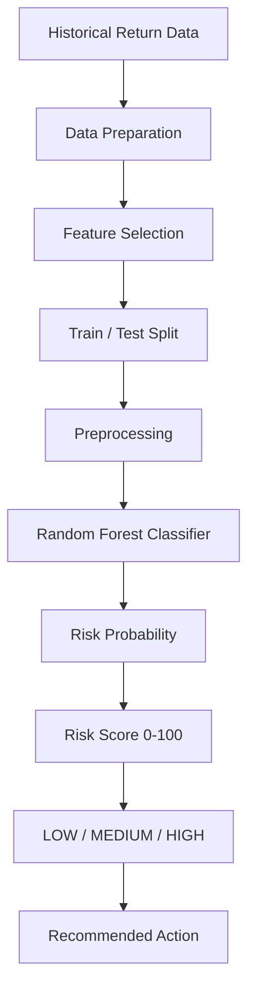

# 🛍️ Fashion Return Risk

### E-Commerce Return Fraud Risk Detection & Decision-Support Platform

An end-to-end machine learning prototype that analyzes e-commerce return requests and estimates their **risk level** using customer return behavior, transaction patterns, and return-request details.

The project is designed as a **decision-support system**: a high-risk result should trigger additional verification or manual review rather than automatically accusing a customer of fraud.

---

## ✨ Project Overview

E-commerce platforms process thousands of return requests, making it difficult to manually identify unusual patterns.

This project demonstrates how historical return behavior can be converted into a machine-learning-based **risk score from 0–100**.

The application provides:

- 📊 Return-risk scoring
- 🚦 LOW / MEDIUM / HIGH risk classification
- 👤 Customer behavior analysis
- 🧾 Transaction and return-pattern analysis
- 🔍 Explainable risk indicators
- 🖼️ Optional original-vs-returned image comparison
- 📈 Historical return analytics
- 🌐 Interactive Streamlit dashboard

---

## 🎯 Problem Statement

A return request may look normal when viewed individually, but patterns across multiple transactions can reveal unusual behavior.

For example:

- A customer has a very high historical return rate.
- Several returns were made within a short period.
- Previous return disputes exist.
- A high-value order is being returned.
- The selected return reason is associated with additional review signals.

The system combines these signals to produce a risk estimate that can help an operations team decide whether a return should be processed normally or reviewed further.

---

## 🧠 Machine Learning Workflow



### Model pipeline

1. Generate/load return-history data.
2. Separate input features from the target label.
3. Process numerical and categorical features.
4. Split data into training and testing sets.
5. Train a **Random Forest classifier**.
6. Generate a probability for the positive risk class.
7. Convert the probability into a 0–100 risk score.
8. Map the score to LOW, MEDIUM, or HIGH risk.
9. Display the result through Streamlit.

---

## 🔍 Features Used

### Customer / Behaviour Features

| Feature | Meaning |
|---|---|
| `orders` | Total number of customer orders |
| `returns` | Total historical returns |
| `returns_30d` | Returns made during the last 30 days |
| `disputes` | Previous return disputes |

### Transaction Features

| Feature | Meaning |
|---|---|
| `amount` | Order value |
| `days_to_return` | Days between purchase and return |

### Categorical Features

| Feature | Examples |
|---|---|
| `category` | dress, shoes, jacket, jeans |
| `reason` | damaged, wrong_size, changed_mind |
| `payment` | card, UPI, COD, wallet |

---

## 🚦 Risk Scoring

The trained model produces a probability, which is displayed as a risk score.

| Score | Level | Suggested Action |
|---:|---|---|
| 0–34 | 🟢 LOW | Normal processing |
| 35–69 | 🟡 MEDIUM | Additional verification |
| 70–100 | 🔴 HIGH | Manual review |

**Important:** These thresholds are prototype decision rules and should be validated with real business data before production use.

---

## 💡 Explainable Risk Signals

The dashboard also highlights simple behavioural signals that may have contributed to a review recommendation, such as:

- High historical return rate
- Several recent returns
- Previous return disputes
- Very short return time
- High-value order
- Certain return reasons

This makes the output easier to understand than showing only a raw model probability.

---

## 🖼️ Optional Image Comparison

The application supports an optional comparison between:

**Original Product Image → Returned Item Image**

Perceptual hashing is used to calculate a simple visual similarity measure.

```text
Original Image
      │
      ▼
Perceptual Hash
      │
      ├──────────────┐
      │              │
Returned Image      │
      │              │
      ▼              │
Perceptual Hash     │
      │              │
      └──────► Hash Distance
                     │
                     ▼
              Similarity Score
```

A low similarity result can be surfaced as an additional signal for manual inspection.

This image comparison is **not a standalone fraud detector**.

---

## 📊 Dataset Distribution

The repository contains a synthetic dataset of **10,000 return records** for development and demonstration.

### Risk-label distribution


### Product-category distribution


### Order-value distribution


### Historical return-rate distribution


> The dataset is synthetic. Its distributions and labels should not be interpreted as real-world e-commerce statistics.

---

## 📈 Application Dashboard

The Streamlit application contains three main areas:

### 1. Return Risk Analysis
Enter customer and order information and generate a risk score.

### 2. Image Comparison
Optionally upload the original and returned-item images to compare their visual similarity.

### 3. Historical Analytics
Explore the included synthetic return dataset through summary metrics and category-level analysis.

---

## 🗂️ Project Structure

```text
fashion-return-risk/
│
├── 📄 app.py
├── 📄 train_model.py
├── 📄 synthetic_data.py
├── 📄 requirements.txt
├── 📄 README.md
├── 📄 LICENSE
├── 🤖 model.pkl
│
├── 📁 data/
│   └── returns.csv
│
└── 📁 assets/
    ├── risk_label_distribution.png
    ├── category_distribution.png
    ├── order_value_distribution.png
    └── return_rate_distribution.png
```

### File responsibilities

| File | Purpose |
|---|---|
| `app.py` | Streamlit user interface and prediction flow |
| `train_model.py` | Data preparation, model training and evaluation |
| `synthetic_data.py` | Generates the demonstration dataset |
| `model.pkl` | Saved trained ML pipeline |
| `data/returns.csv` | Synthetic return records |
| `assets/` | README visualizations |
| `requirements.txt` | Python dependencies |

---

## 🛠️ Technologies Used

| Technology | Purpose |
|---|---|
| 🐍 Python | Application and ML logic |
| 🎨 Streamlit | Interactive web dashboard |
| 🐼 Pandas | Data processing and analysis |
| 🔢 NumPy | Numerical operations |
| 🤖 Scikit-learn | ML preprocessing, training and evaluation |
| 🌲 Random Forest | Classification model |
| 🖼️ Pillow | Image handling |
| 🔎 ImageHash | Perceptual image comparison |
| 📦 Pickle | Model serialization |

---

## 🚀 How to Run Locally

### 1. Clone the repository

```bash
git clone <YOUR_GITHUB_REPOSITORY_URL>
```

### 2. Enter the project directory

```bash
cd fashion-return-risk
```

### 3. Create a virtual environment

**Windows**

```bash
python -m venv .venv
.venv\Scripts\activate
```

**macOS / Linux**

```bash
python3 -m venv .venv
source .venv/bin/activate
```

### 4. Install dependencies

```bash
pip install -r requirements.txt
```

### 5. Generate the demonstration dataset if needed

```bash
python synthetic_data.py
```

### 6. Train the model

```bash
python train_model.py
```

This creates:

```text
model.pkl
```

### 7. Launch the Streamlit application

```bash
streamlit run app.py
```

Then open the local URL shown by Streamlit, usually:

```text
http://localhost:8501
```

---

## 🧪 Example Flow

```text
Customer + Order Details
          ↓
   Feature Processing
          ↓
 Random Forest Model
          ↓
 Risk Probability
          ↓
    Risk Score /100
          ↓
 LOW / MEDIUM / HIGH
          ↓
 Recommended Action
```

Example:

```text
Risk Score: 78/100
Risk Level: HIGH

Recommended Action:
Manual inspection recommended

Risk Signals:
⚠️ High historical return rate
⚠️ Several recent returns
⚠️ Previous return disputes
```

---

## ☁️ Deployment

The application is **Streamlit-compatible** and can be deployed using Streamlit Community Cloud or another Python-compatible hosting platform.

Before deployment, make sure:

- `requirements.txt` is up to date.
- The model file is available or generated during setup.
- The application does not expose private customer information.
- Production data is validated and handled securely.

**Do not claim the project is deployed until you have actually deployed it.**

---

## ⚠️ Limitations

This project is an educational prototype.

- The dataset is synthetic.
- The fraud/risk labels are generated using rules for demonstration.
- Synthetic model performance does not represent real-world fraud-detection performance.
- Image similarity is only an additional signal.
- The system should not automatically accuse customers of fraud.
- Real deployment would require validated historical data, privacy controls, fairness testing, monitoring, audit logging and domain review.

---

## 🔮 Future Improvements

Possible extensions include:

- Real e-commerce return datasets
- Better fraud-label validation
- Customer-level historical tracking
- Advanced anomaly detection
- More robust image models
- Authentication and role-based access
- Database integration
- API-based prediction service
- Model monitoring
- Explainable AI techniques
- Human-review feedback loop

---

## 📌 Project Objective

The goal is to demonstrate how **machine learning + behavioural analytics + an interactive dashboard** can support operational decision-making in e-commerce return processing.

---

## 👩‍💻 Author

**Smruti Smaranika Panda**

Python | Machine Learning | Data Analysis | SQL

> Built as an educational machine-learning project focused on practical e-commerce risk analytics.

---

## ⭐ Note

This project is intended for **learning, demonstration and portfolio purposes**. It is not a professional fraud-detection or financial system.
